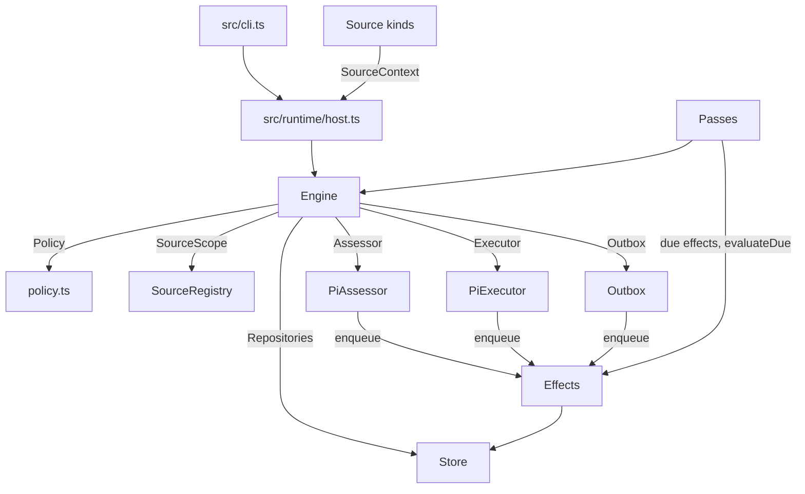

# 007 Architecture

This is the developer guide to the implementation. It maps the concepts of [001 Domain model](001-domain.md) through
[006 Deployment](006-deployment.md) to files, and states where the line between the domain and the runtime sits. Start
with the layers, then use the module table as a code index.

## Layers

The repository is split along the line the original already drew: everything that decides **whether** work may happen
is harness-free, and everything that actually **thinks and acts** sits behind two ports.



| Layer | Depends on | Cannot |
| --- | --- | --- |
| `src/core/` | `node:crypto` and itself | read the clock without being given one, do I/O, call a model, or know a harness |
| `src/policy.ts`, `src/admission.ts` | `core`, `zod` | perform a side effect |
| `src/runtime/`, `src/store/` | `core`, `node:sqlite` | decide anything about authorization |
| `src/sources/` | `core`, `infra/commands.ts` | write to the Engine except through `SourceContext.receive` |
| `src/agents/` | `core` ports, Pi | be reached from `core` |

`src/core/` imports nothing but `node:crypto`; the original test suite for it runs unmodified
([Testing](#testing)). That is the property the whole design exists to protect: the runtime underneath was replaced
once already without touching a line of it.

## The port boundary

`src/core/ports.ts` reduces everything outside the domain to six interfaces. Two are cognitive and were replaced; four
are mechanical and were kept.

| Port | Implemented by | Cognitive |
| --- | --- | --- |
| `Executor` | `src/agents/pi-executor.ts` | yes — it runs the work |
| `Assessor` | `src/agents/pi-assessor.ts` | yes — it judges work |
| `Repositories` | `src/store/store.ts` | no |
| `Policy` | `src/policy.ts` | no — deterministic code |
| `SourceScope` | `src/sources/registry.ts` | no |
| `Outbox` | `src/runtime/outbox.ts` | no |

`Executor` and `Assessor` are fire-and-forget: they queue work and report facts back through the Engine inside the
Engine's own transaction. That is why replacing them did not touch the domain.

```ts
interface Executor {
  start(ticket: Ticket, assignment: Assignment): void
  deliver(ticket: Ticket, assignment: Assignment): void
  stop(ticket: Ticket, assignment: Assignment, reason: string): void
}
interface Assessor {
  request(candidate: Candidate): void
  release?(evalId: string): void
}
```

## Modules

| Part | Module | Does |
| --- | --- | --- |
| Model | `src/core/model.ts` | The concepts and their invariants; pure types and functions |
| Ports | `src/core/ports.ts` | The six interfaces above, and the domain event union |
| Engine | `src/core/engine.ts` | The single transactional entry point; delegates to five parts |
| Tickets | `src/core/tickets.ts` | The Ticket lifecycle, subscriptions, resume, stop, attachments |
| Evals | `src/core/evals.ts` | Batching, the gate's result, candidates, requeue, the Decision |
| Assignments | `src/core/assignments.ts` | What the Executor reports: started, delivered, read, turn ended, report |
| Replies | `src/core/replies.ts` | Channel writes through the `Outbox`, by the rule that allows each |
| Intake | `src/core/intake.ts` | A Source's Trigger: stored once, fanned out, queued for Eval |
| Stage | `src/core/stage.ts` | The stage table of [003](003-execution.md#ticket-stages) |
| Memory repositories | `src/core/memory.ts` | In-memory `Repositories` for tests |
| Policy | `src/policy.ts` | Settings schema, the gate, assessment validation, policy version and effects |
| Admission | `src/admission.ts` | The admission matrix and its defaults |
| Store | `src/store/store.ts` | SQLite: aggregates, KV, settings history, receipts |
| Store reads | `src/store/store-read.ts` | Read queries for the CLI and Source polling |
| Versions | `src/store/versions.ts` | Numbered snapshots behind a current-revision pointer |
| Coordination | `src/runtime/passes.ts` | One pass at a time, every two seconds and on demand |
| Effects | `src/runtime/effects.ts` | Durable side effects with concurrency limits, backoff and health |
| Outbox | `src/runtime/outbox.ts` | Message receipts and delivery |
| Host | `src/runtime/host.ts` | Composition root: locks the state directory, builds everything, recovers |
| Pi sessions | `src/agents/sessions.ts` | One Pi session per ticket, pinned to a session file |
| Pi executor | `src/agents/pi-executor.ts` | The `Executor`: launch, steer, report, slots, prepare |
| Pi assessor | `src/agents/pi-assessor.ts` | The `Assessor`: one bounded session per candidate |
| Report tool | `src/agents/report-tool.ts` | The worker's structured report |
| Environment | `src/agents/environment.ts` | Execution variables and the prepare command |
| Source registry | `src/sources/registry.ts` | Installed kinds, their instances, and `SourceScope` |
| Source contract | `src/sources/kind.ts` | What a Source kind is |
| Source host | `src/sources/host.ts` | What a Source kind may read and write |
| GitHub | `src/sources/github.ts` | Notifications, repository streams, CI, subscribed threads |
| GitHub triggers | `src/sources/github-trigger.ts` | GitHub payloads as Triggers |
| GitHub pulls | `src/sources/github-pull.ts` | PR reads, observation, ticket binding |
| GitHub channel | `src/sources/github-channel.ts` | Comments and review replies, idempotent by marker |
| GitHub CI | `src/sources/github-read.ts` | Check snapshots and the facts a thread publishes |
| Polling | `src/sources/poll.ts` | Subscribed-thread polling and its 14-day horizon |
| Commands | `src/infra/commands.ts` | `gh` and `git` subprocesses, scoped to the repository |
| Health | `src/infra/health.ts` | The health board and its single-writer rule |
| Config | `src/config.ts` | The deployment shape, and resolving the agent account |
| KV | `src/kv.ts` | Typed keys and key families |
| Prompts | `src/prompts.ts` | Loading `prompts/*.md` from the package root |
| CLI | `src/cli.ts` | [005 CLI](005-cli.md) |

## Two loops, one clock

`Passes` runs a pass every two seconds and on demand. A pass drains due effects, then lets the Engine advance every
evaluation that is due. Sources call `SourceContext.receive`, which stores the Trigger and requests a pass; a Source
never runs the Engine itself.

Everything the Engine changes is written inside one SQLite transaction. Anything that must survive a crash is an
**effect**: a row in the `effect` table that a handler picks up after the commit. There are four:

| Effect | Key | Handler | Limit |
| --- | --- | --- | --- |
| `assessment` | Eval id | `PiAssessor.assess` | 
| `launch` | Assignment id | `PiExecutor.launch` | 
| `delivery` | Ticket id | `PiExecutor.deliverTo` | 8, ordered |
| `reply` | Message id | `Outbox.deliver` | 1, retried up to 5 min |

Each handler's `limit` returns 0 while `settings.paused`, which is what pausing means: nothing new starts, and what is
running is left to finish. A handler that finds no capacity throws `Later`, which reschedules the row after the initial
delay without counting it as a failure — the difference between "not now" and "it broke".

## Configuring the agents

Both agents are configured by the same three inputs, which is why `sessions.ts` is small:

| Concern | Where |
| --- | --- |
| Model route, reasoning level | `settings.eval.model`, `settings.executor.model`, resolved through Pi's `ModelRuntime` |
| System prompt | `prompts/assess.md` (replaces) and `prompts/work.md` (appends); see [004](004-prompts.md) |
| Tools | The Assessor runs `noTools: 'builtin'` with one custom tool; the Worker keeps Pi's defaults plus `report` |

An earlier version of the Assessor passed `tools: []`, which in Pi is an **allowlist** and therefore disabled its own
`decide` tool. `noTools` is a denylist and is the correct choice when a tool must survive.

## Testing

`pnpm check` runs the typecheck, the tests and the build.

| Suite | Covers |
| --- | --- |
| `tests/core-engine.spec.ts` | 113 tests, **carried over unchanged** from the original: the Ticket lifecycle, subscriptions, follow-ups, revalidation, policy effects |
| `tests/policy.spec.ts` | The gate, revalidation, policy version, assessment validation |
| `tests/store.spec.ts` | Transactions, `afterCommit`, receipts, generated columns |
| `tests/host.spec.ts` | Composition, the state lock, recovery, `prepareTicket` |

Two things are tested only by running them, because a fake would not model them: steering reaches a working worker
(`scripts/probe-steer.ts`, results in [003](003-execution.md#steering)), and a real GitHub round trip (the bootstrap run
in the README).

## Extending

A new Source is `src/sources/<kind>.ts` implementing `SourceKind`, registered by `Host.register`. [008 Cookbook](008-cookbook.md)
walks through it.

## Known structural limits

| Limit | Why it is deliberate |
| --- | --- |
| `Engine` is synchronous | Every command is one transaction, and a port cannot await in the middle of it. Making the domain async would let a slow store interleave two commands. |
| One process per state directory | `Host` takes a lock on the directory. Two replicas need either shared storage and a rewritten `Repositories`, or an event-only protocol between them. |
| No correlation producers | `Thread.correlated` exists in the domain, but every GitHub Trigger belongs to one Thread, so the mechanism is unexercised. |
