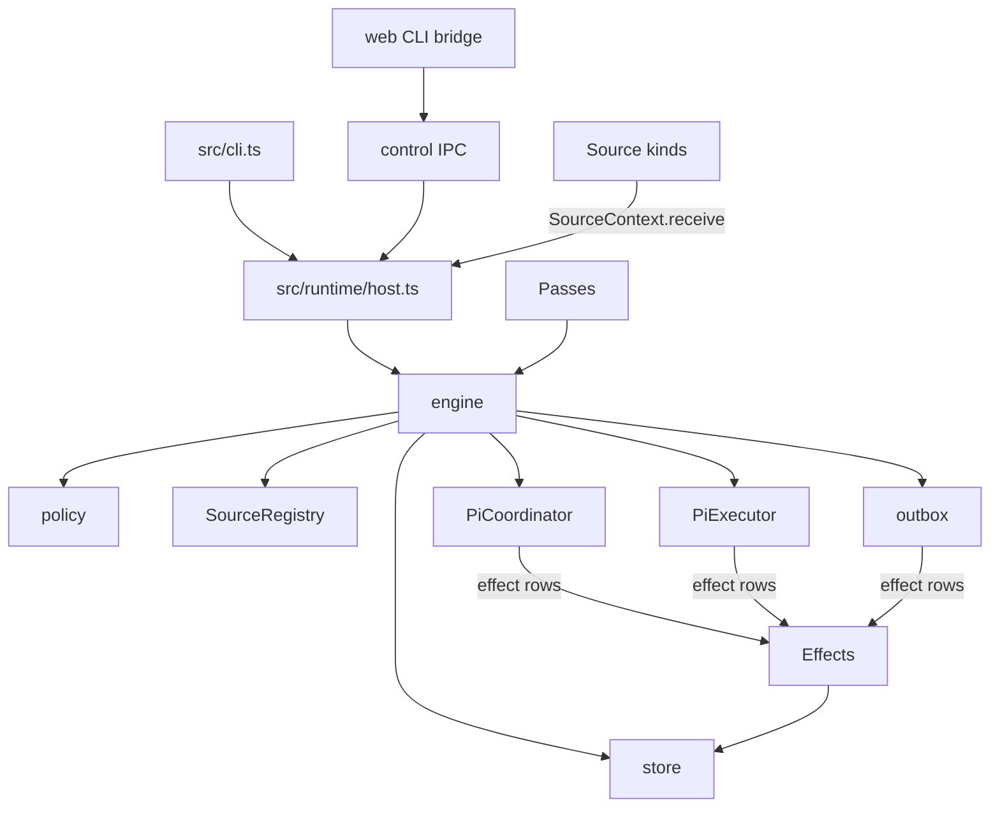

# 007 Architecture

This document maps the domain concepts of [001 Domain model](001-domain.md) to the implementation and states the runtime
boundary. It builds on [006 Deployment](006-deployment.md).

## Layers

The repository keeps domain authorization independent of the runtime. Everything that decides whether work may happen is
harness-free; thinking and acting use Pi sessions behind domain ports.

| Layer | Depends on | Cannot |
| --- | --- | --- |
| `src/core/` | itself and `node:crypto` | I/O, clock assumptions, model calls or harness knowledge |
| `src/policy.ts`, `src/admission.ts` | `core`, `zod` | perform side effects |
| `src/runtime/`, `src/store/` | `core`, SQLite | decide authorization |
| `src/sources/` | `core`, source context and standard library | change domain state except through `SourceContext.receive` or the channel contract |
| `src/agents/` | Pi SDK and domain ports | be imported by `core` |

## The port boundary

`src/core/ports.ts` keeps the domain behind ports.

| Port | Implemented by | Role |
| --- | --- | --- |
| `Executor` | `src/agents/pi-executor.ts` | runs Ticket Assignments in persistent worker sessions |
| `Assessor` | `src/agents/pi-coordinator.ts` through `PiCoordinator` | investigates candidates and records assessment Decisions |
| `Repositories` | `src/store/store.ts` | transactional domain persistence |
| `Policy` | `src/policy.ts` | deterministic gate and policy revalidation |
| `SourceScope` | `src/sources/registry.ts` | listens and observes according to installed Source kinds |
| `Outbox` | `src/runtime/outbox.ts` | receipt and retry of outbound messages |

The old separate `pi-assessor.ts` file is deleted. `PiCoordinator` implements the `Assessor` port and also owns routing,
cross-Ticket coordination, replies and operator notifications. The `Executor` remains one persistent Pi session per Ticket.

## Modules

| Part | Module | Does |
| --- | --- | --- |
| Model | `src/core/model.ts` | domain concepts and pure invariants |
| Engine | `src/core/engine.ts` | transactional receive, decide, attach, stop and reply entry points |
| Tickets/Evals/Replies | `src/core/tickets.ts`, `evals.ts`, `replies.ts` | lifecycle, batching, decisions and Channel writes |
| Store | `src/store/store.ts`, `store-read.ts`, `versions.ts` | SQLite aggregates, settings/prompt versions and receipts |
| Coordination passes | `src/runtime/passes.ts` | one pass at a time, every two seconds and on demand |
| Effects | `src/runtime/effects.ts` | durable effect rows, concurrency limits and backoff |
| Host | `src/runtime/host.ts` | composition root, state lock, recovery and Source startup |
| Management | `src/runtime/management.ts`, `src/runtime/control.ts` | running-instance IPC actions and validation |
| Persistent prompts | `src/runtime/prompts.ts` | immutable prompt revisions and active prompt lookup |
| Pi sessions | `src/agents/sessions.ts` | pinned coordinator/worker session files and dynamic Pi resources |
| Pi coordinator | `src/agents/pi-coordinator.ts` | persistent main session, candidate assessment and routing tools |
| Pi executor | `src/agents/pi-executor.ts` | Ticket session, steering, prepare, report and delivery |
| Coordinator tools | `src/agents/coordinator-tools.ts` | bounded domain resources and typed routing/management tools |
| Worker tools | `src/agents/worker-tools.ts`, `report-tool.ts` | report, handback, acknowledgement and context tools |
| Source registry | `src/sources/registry.ts` | installed kinds, enabled instances and scopes |
| Sources | `src/sources/github.ts`, `im.ts`, `inbox.ts` | repository streams, local channels and generic external events |
| Web | `src/web/server.ts`, `web/` | CLI bridge, loopback management HTTP and static React panel |
| CLI | `src/cli.ts`, `src/cli/commands/` | local inspection and management commands |

## Runtime loops

`Passes` runs one pass every two seconds and after receiving or managing a change. A Source calls `SourceContext.receive`; it
does not call the Engine or evaluate itself.

Every domain change is committed in one SQLite transaction. Operations that must survive a crash are effect rows:

| Effect | Key | Handler |
| --- | --- | --- |
| `assessment` | Eval id | `PiCoordinator.assess` |
| `coordination` | notification id | `PiCoordinator` persistent-session notification |
| `launch` | Assignment id | `PiExecutor.launch` |
| `delivery` | Ticket id | `PiExecutor.deliverTo` |
| `reply` | Message id | `Outbox.deliver` |

Ordinary effect failures remain in the queue and back off. `Later` reschedules a capacity or pause wait without counting
it as a provider failure. Replied messages and Inbox JSONL rows are idempotent by message id.

The implementation does not use Pi built-in durable jobs or subagents as infrastructure. It has one coordinator session,
one worker session per Ticket, and one ordinary process-owned effect queue.

## Management and prompts

Running instances receive configuration and prompt writes through local runtime control IPC. Read commands still open the
SQLite state when the process is stopped, and the web command forwards management requests through the same CLI/IPC
control path.

Prompt versions are immutable snapshots in SQLite. `PiSessions` asks for the current prompt at the start of the next
session turn and records the revision in the session file. Settings changes notify the coordinator and request a new
pass. This is hot next-run prompt application, not rewriting an already-running model turn.

## Pi resources

Pi sessions use SDK 1.4.0 `DefaultResourceLoader`, the session working directory and the Pi agent directory. Dynamic
resources can include extensions, skills, MCP tools/resources, codemode and tool search. Project tools are explicit and
bounded; MCP or skill discovery does not replace domain authorization or typed state transitions.

The coordinator can read bounded Tickets, Threads and Triggers, and repository files when GitHub context is configured.
Workers keep ordinary Pi tools plus project reporting and collaboration tools.

## Effects and limits

Each handler has a concurrency limit. Paused processing leaves running work alone and prevents new effects from starting.
The effect table is durable but has no separate distributed worker pool. One process owns one state directory and serializes
its SQLite changes.

## Testing

`pnpm check` runs typechecking, the build and test suites. When concurrent repository changes make the full suite noisy,
`pnpm exec vitest run tests/docs.spec.ts` is the bounded documentation-link check.

Structural tests cover the core, policy, store, host, CLI, management, Inbox and Source behavior. Live steering and live
model probes are separate scripts; `scripts/probe-system.ts` is run by `pnpm test:live` only when the operator wants a real
model call.

## Known structural limits

| Limit | Why it remains |
| --- | --- |
| `Engine` is synchronous | It keeps every mutation one transaction and the `Repositories` contract small |
| One process per state directory | `Host` takes a lock; replicas require shared repositories or an event protocol |
| No correlation producer | `Thread.correlated` exists, but current Sources do not yet produce many-Thread Triggers |
| No job/subagent framework | Not implemented by this project; Pi 1.4 primitives are not converted into a project-owned supervisor |
| GitHub is optional | Core, Inbox and IM work without repository or account configuration |
